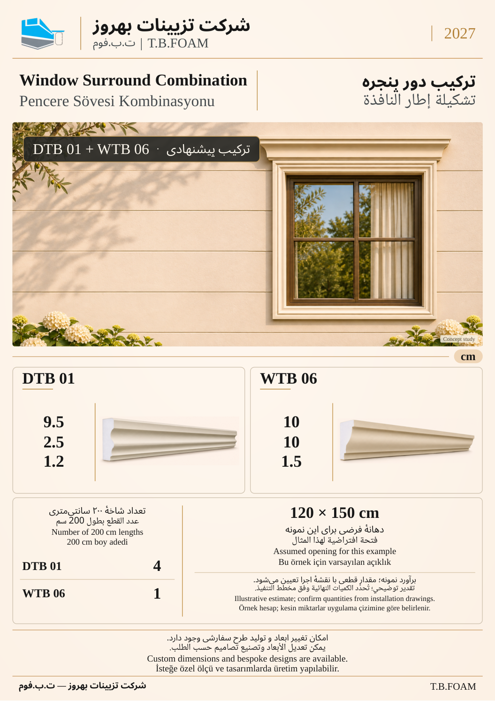

# نمونهٔ 1: قاب پنجره با تاج بالاسری

[فهرست ۱۲ صفحه](README.md) · [بعدی](02.md)

**ابزارهای این ترکیب:** **DTB 01** + **WTB 06**

| کد محصول | کاربرد در تصویر |
| --- | --- |
| DTB 01 | قاب چهارطرفه |
| WTB 06 | تاج مستقل بالای قاب |

مثال محاسبه: دهانهٔ فرضی ۱۲۰×۱۵۰ سانتی‌متر؛ ۴ شاخهٔ دو متری DTB 01 و ۱ شاخهٔ دو متری WTB 06، با فرض‌های همین نمونه. مقدار قطعی به نقشهٔ اجرا و برش وابسته است.

ابعاد درج‌شده بر حسب سانتی‌متر است. شمارهٔ این نمونه فقط ترتیب بازبینی است؛ شمارهٔ نهایی کاتالوگ بعداً تعیین می‌شود. تصویر کاربرد، مطالعهٔ مفهومی طراحی است؛ نقشهٔ اجرایی یا تصویر پروژهٔ اجراشده معرفی نمی‌شود.

[فهرست ۱۲ صفحه](README.md) · [بعدی](02.md)
