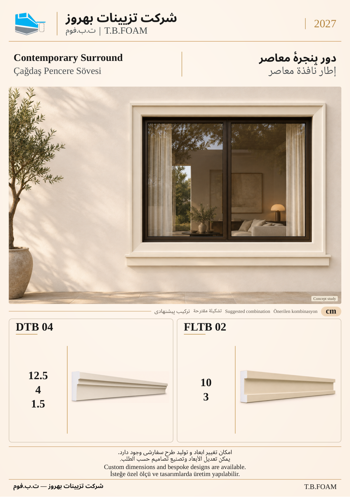

# نمونهٔ 2: دور پنجرهٔ معاصر

[قبلی](01.md) · [فهرست ۱۲ صفحه](README.md) · [بعدی](03.md)

**ابزارهای این ترکیب:** **DTB 04** + **FLTB 02**

| کد محصول | کاربرد در تصویر |
| --- | --- |
| DTB 04 | قاب چهارطرفه |
| FLTB 02 | لبهٔ زیر پنجره |

ابعاد درج‌شده بر حسب سانتی‌متر است. شمارهٔ این نمونه فقط ترتیب بازبینی است؛ شمارهٔ نهایی کاتالوگ بعداً تعیین می‌شود. تصویر کاربرد، مطالعهٔ مفهومی طراحی است؛ نقشهٔ اجرایی یا تصویر پروژهٔ اجراشده معرفی نمی‌شود.

[قبلی](01.md) · [فهرست ۱۲ صفحه](README.md) · [بعدی](03.md)
