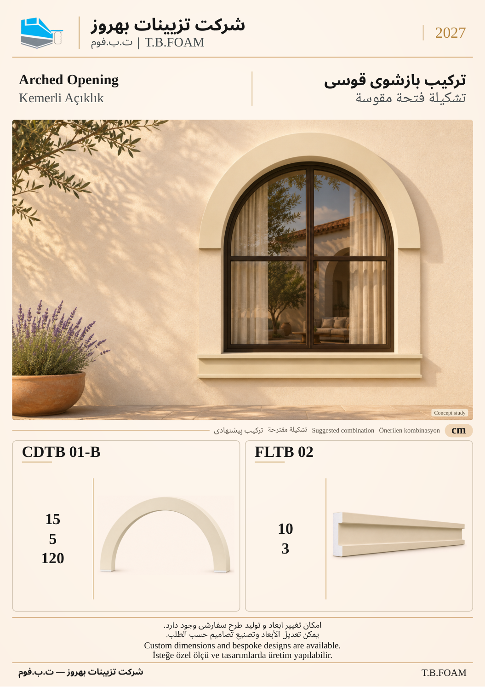

# نمونهٔ 3: ترکیب بازشوی قوسی

[قبلی](02.md) · [فهرست ۱۲ صفحه](README.md) · [بعدی](04.md)

**ابزارهای این ترکیب:** **CDTB 01-B** + **FLTB 02**

| کد محصول | کاربرد در تصویر |
| --- | --- |
| CDTB 01-B | آرک بالای بازشو؛ قطر دایرهٔ مدل ۱۲۰، نه ادعای دهانهٔ خالص |
| FLTB 02 | لبهٔ افقی زیر پنجره |

عدد ۱۲۰ مربوط به قطر دایرهٔ مدل آرک است و به‌عنوان دهانهٔ خالص پنجره تعریف نشده است.

ابعاد درج‌شده بر حسب سانتی‌متر است. شمارهٔ این نمونه فقط ترتیب بازبینی است؛ شمارهٔ نهایی کاتالوگ بعداً تعیین می‌شود. تصویر کاربرد، مطالعهٔ مفهومی طراحی است؛ نقشهٔ اجرایی یا تصویر پروژهٔ اجراشده معرفی نمی‌شود.

[قبلی](02.md) · [فهرست ۱۲ صفحه](README.md) · [بعدی](04.md)
