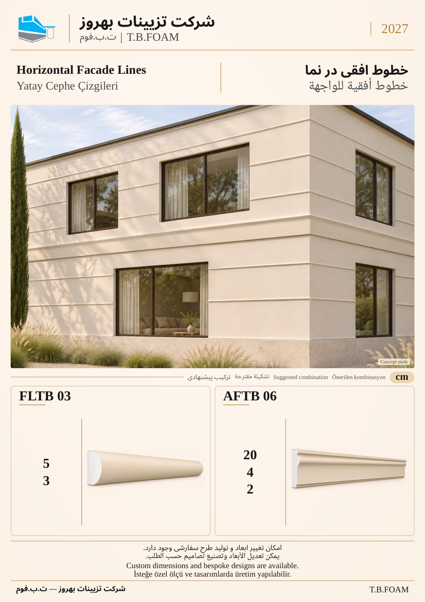

# نمونهٔ 4: خطوط افقی در نما

[قبلی](03.md) · [فهرست ۱۲ صفحه](README.md) · [بعدی](05.md)

**ابزارهای این ترکیب:** **FLTB 03** + **AFTB 06**

| کد محصول | کاربرد در تصویر |
| --- | --- |
| FLTB 03 | نوار باریک در تقسیم سطح نما |
| AFTB 06 | ابزار افقی پهن‌تر در تراز طبقه |

ابعاد درج‌شده بر حسب سانتی‌متر است. شمارهٔ این نمونه فقط ترتیب بازبینی است؛ شمارهٔ نهایی کاتالوگ بعداً تعیین می‌شود. تصویر کاربرد، مطالعهٔ مفهومی طراحی است؛ نقشهٔ اجرایی یا تصویر پروژهٔ اجراشده معرفی نمی‌شود.

[قبلی](03.md) · [فهرست ۱۲ صفحه](README.md) · [بعدی](05.md)
