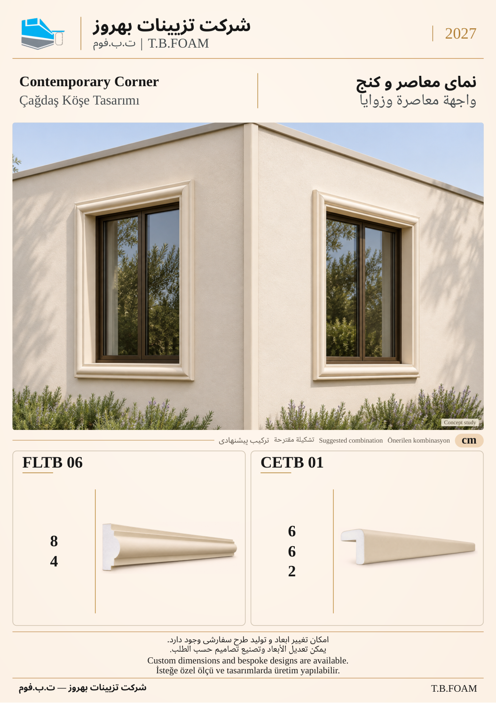

# نمونهٔ 5: نمای معاصر و کنج

[قبلی](04.md) · [فهرست ۱۲ صفحه](README.md) · [بعدی](06.md)

**ابزارهای این ترکیب:** **FLTB 06** + **CETB 01**

| کد محصول | کاربرد در تصویر |
| --- | --- |
| FLTB 06 | خطوط نما و تأکید پیرامون بازشو |
| CETB 01 | پوشش کنج بیرونی |

ابعاد درج‌شده بر حسب سانتی‌متر است. شمارهٔ این نمونه فقط ترتیب بازبینی است؛ شمارهٔ نهایی کاتالوگ بعداً تعیین می‌شود. تصویر کاربرد، مطالعهٔ مفهومی طراحی است؛ نقشهٔ اجرایی یا تصویر پروژهٔ اجراشده معرفی نمی‌شود.

[قبلی](04.md) · [فهرست ۱۲ صفحه](README.md) · [بعدی](06.md)
