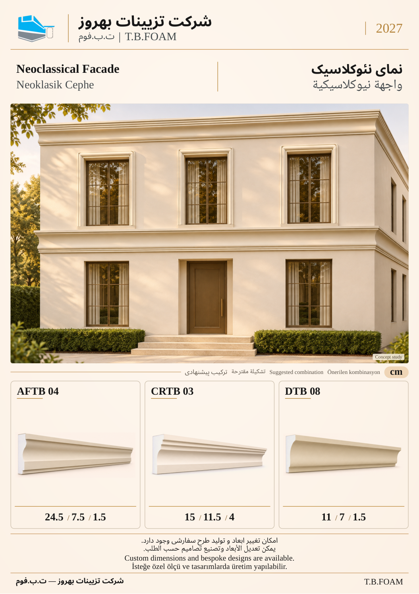

# نمونهٔ 6: نمای نئوکلاسیک

[قبلی](05.md) · [فهرست ۱۲ صفحه](README.md) · [بعدی](07.md)

**ابزارهای این ترکیب:** **AFTB 04** + **CRTB 03** + **DTB 08**

| کد محصول | کاربرد در تصویر |
| --- | --- |
| AFTB 04 | نوار افقی بین طبقات |
| CRTB 03 | تاج خط بام |
| DTB 08 | قاب پیرامون پنجره |

ابعاد درج‌شده بر حسب سانتی‌متر است. شمارهٔ این نمونه فقط ترتیب بازبینی است؛ شمارهٔ نهایی کاتالوگ بعداً تعیین می‌شود. تصویر کاربرد، مطالعهٔ مفهومی طراحی است؛ نقشهٔ اجرایی یا تصویر پروژهٔ اجراشده معرفی نمی‌شود.

[قبلی](05.md) · [فهرست ۱۲ صفحه](README.md) · [بعدی](07.md)
