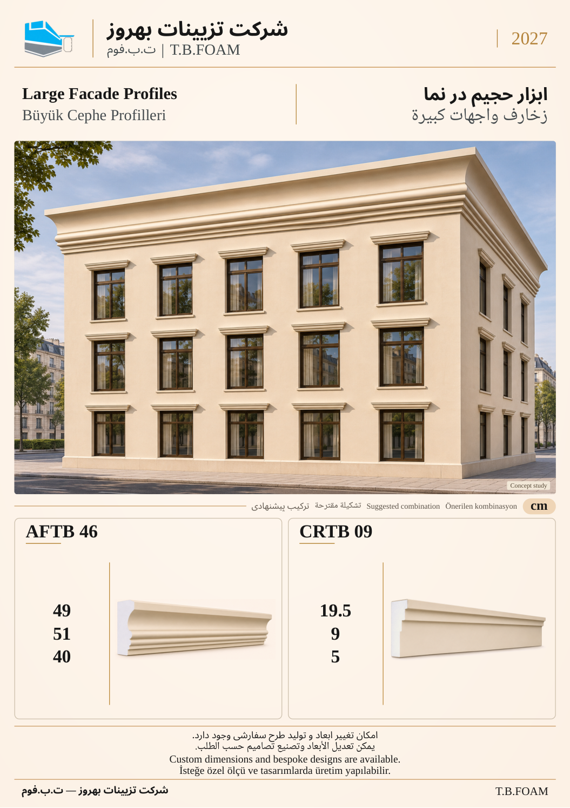

# نمونهٔ 7: ابزار حجیم در نما

[قبلی](06.md) · [فهرست ۱۲ صفحه](README.md) · [بعدی](08.md)

**ابزارهای این ترکیب:** **AFTB 46** + **CRTB 09**

| کد محصول | کاربرد در تصویر |
| --- | --- |
| AFTB 46 | پیشانی حجیم خط بام |
| CRTB 09 | تاج در تراز بالای بازشوها |

ابعاد درج‌شده بر حسب سانتی‌متر است. شمارهٔ این نمونه فقط ترتیب بازبینی است؛ شمارهٔ نهایی کاتالوگ بعداً تعیین می‌شود. تصویر کاربرد، مطالعهٔ مفهومی طراحی است؛ نقشهٔ اجرایی یا تصویر پروژهٔ اجراشده معرفی نمی‌شود.

[قبلی](06.md) · [فهرست ۱۲ صفحه](README.md) · [بعدی](08.md)
