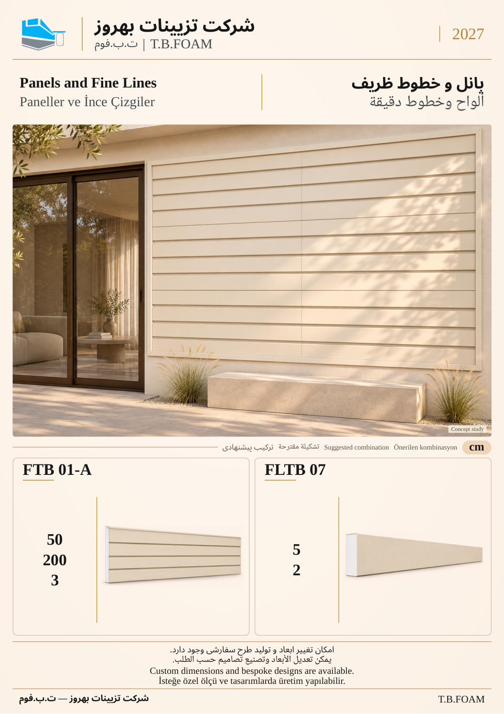

# نمونهٔ 8: پانل و خطوط ظریف

[قبلی](07.md) · [فهرست ۱۲ صفحه](README.md) · [بعدی](09.md)

**ابزارهای این ترکیب:** **FTB 01-A** + **FLTB 07**

| کد محصول | کاربرد در تصویر |
| --- | --- |
| FTB 01-A | پانل نما با عرض ۵۰، طول ۲۰۰، ضخامت ۳ |
| FLTB 07 | نوار باریک برای قاب‌بندی سطح |

ابعاد درج‌شده بر حسب سانتی‌متر است. شمارهٔ این نمونه فقط ترتیب بازبینی است؛ شمارهٔ نهایی کاتالوگ بعداً تعیین می‌شود. تصویر کاربرد، مطالعهٔ مفهومی طراحی است؛ نقشهٔ اجرایی یا تصویر پروژهٔ اجراشده معرفی نمی‌شود.

[قبلی](07.md) · [فهرست ۱۲ صفحه](README.md) · [بعدی](09.md)
