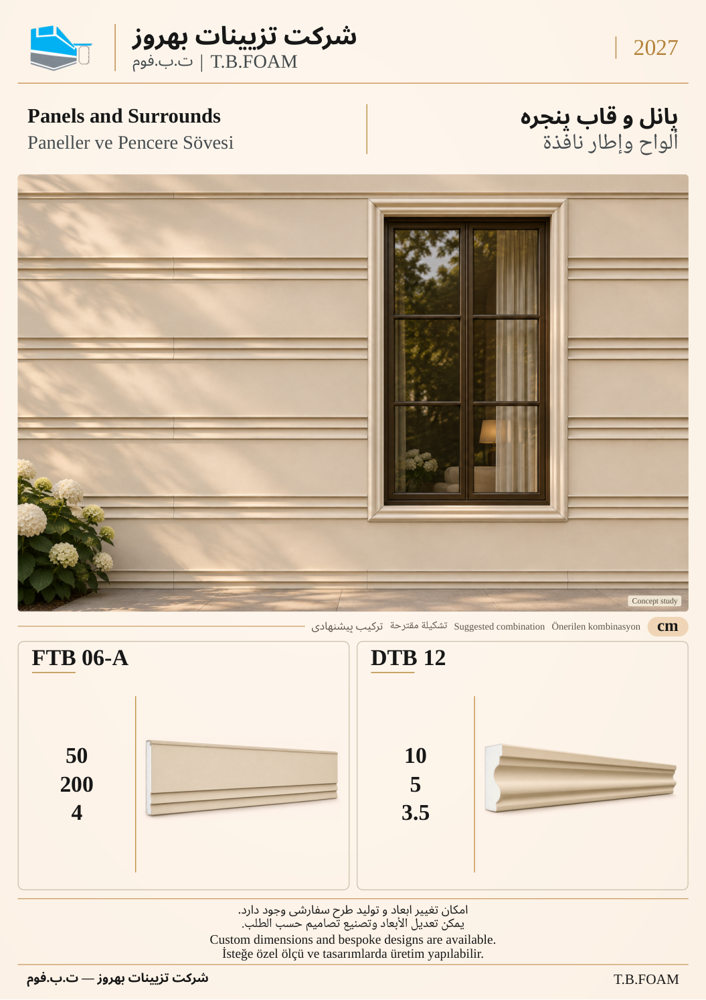

# نمونهٔ 9: پانل و قاب پنجره

[قبلی](08.md) · [فهرست ۱۲ صفحه](README.md) · [بعدی](10.md)

**ابزارهای این ترکیب:** **FTB 06-A** + **DTB 12**

| کد محصول | کاربرد در تصویر |
| --- | --- |
| FTB 06-A | پانل نما با عرض ۵۰، طول ۲۰۰، ضخامت ۴ |
| DTB 12 | قاب پیرامون بازشو در سطح پانلی |

ابعاد درج‌شده بر حسب سانتی‌متر است. شمارهٔ این نمونه فقط ترتیب بازبینی است؛ شمارهٔ نهایی کاتالوگ بعداً تعیین می‌شود. تصویر کاربرد، مطالعهٔ مفهومی طراحی است؛ نقشهٔ اجرایی یا تصویر پروژهٔ اجراشده معرفی نمی‌شود.

[قبلی](08.md) · [فهرست ۱۲ صفحه](README.md) · [بعدی](10.md)
