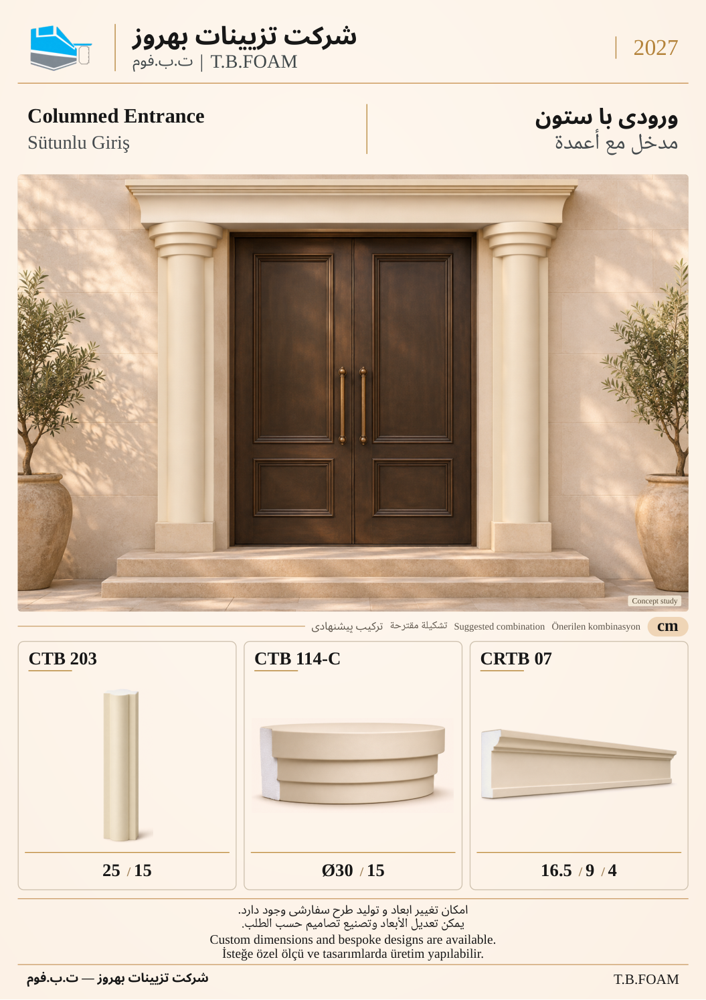

# نمونهٔ 10: ورودی با ستون

[قبلی](09.md) · [فهرست ۱۲ صفحه](README.md) · [بعدی](11.md)

**ابزارهای این ترکیب:** **CTB 203** + **CTB 114-C** + **CRTB 07**

| کد محصول | کاربرد در تصویر |
| --- | --- |
| CTB 203 | بدنهٔ ستون |
| CTB 114-C | سرستون مدور پله‌ای؛ قطر ۳۰ و ارتفاع ۱۵، انتخاب متناسب برای مطالعهٔ بصری ورودی |
| CRTB 07 | تاج بالای ورودی |

ابعاد درج‌شده بر حسب سانتی‌متر است. شمارهٔ این نمونه فقط ترتیب بازبینی است؛ شمارهٔ نهایی کاتالوگ بعداً تعیین می‌شود. تصویر کاربرد، مطالعهٔ مفهومی طراحی است؛ نقشهٔ اجرایی یا تصویر پروژهٔ اجراشده معرفی نمی‌شود.

[قبلی](09.md) · [فهرست ۱۲ صفحه](README.md) · [بعدی](11.md)
