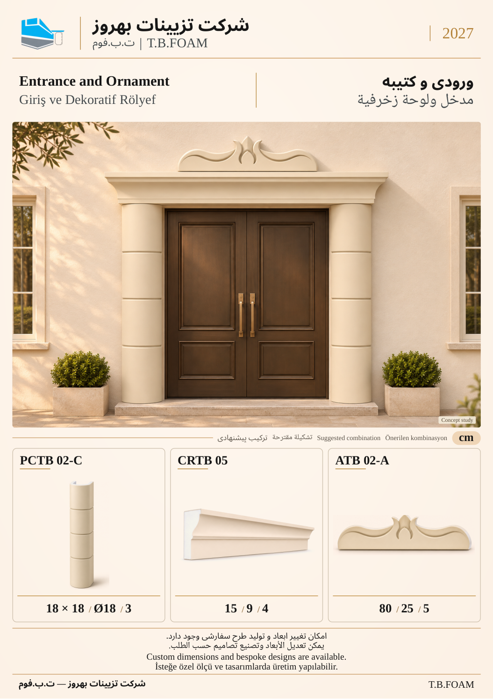

# نمونهٔ 11: ورودی و کتیبه

[قبلی](10.md) · [فهرست ۱۲ صفحه](README.md) · [بعدی](12.md)

**ابزارهای این ترکیب:** **PCTB 02-C** + **CRTB 05** + **ATB 02-A**

| کد محصول | کاربرد در تصویر |
| --- | --- |
| PCTB 02-C | کاور ستون با نمای بیرونی گرد و خط‌های افقی؛ گزینهٔ داخلی ۱۸ و ضخامت ۳؛ مقادیر چهارگوش و گرد در جدول، گزینه‌های جایگزین‌اند |
| CRTB 05 | تاج افقی ورودی |
| ATB 02-A | کتیبهٔ ۸۰×۲۵×۵ بالای ورودی |

در کاور ستون، ۱۸×۱۸ و Ø۱۸ دو حالت مقطع هستند؛ عدد ۳ ضخامت محصول است.

ابعاد درج‌شده بر حسب سانتی‌متر است. شمارهٔ این نمونه فقط ترتیب بازبینی است؛ شمارهٔ نهایی کاتالوگ بعداً تعیین می‌شود. تصویر کاربرد، مطالعهٔ مفهومی طراحی است؛ نقشهٔ اجرایی یا تصویر پروژهٔ اجراشده معرفی نمی‌شود.

[قبلی](10.md) · [فهرست ۱۲ صفحه](README.md) · [بعدی](12.md)
