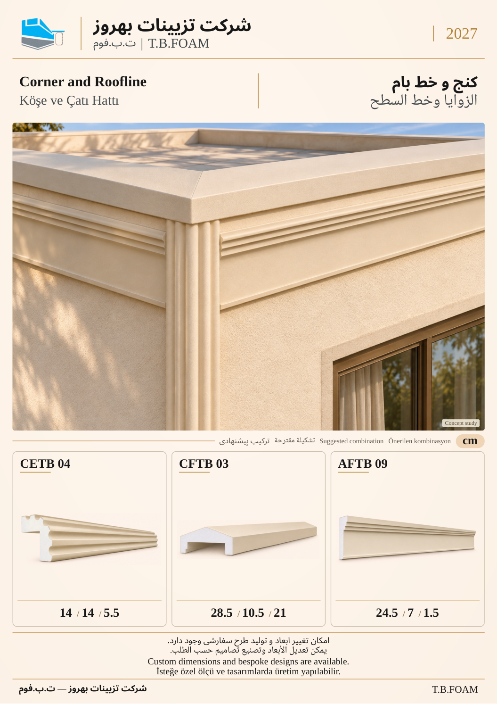

# نمونهٔ 12: کنج و خط بام

[قبلی](11.md) · [فهرست ۱۲ صفحه](README.md)

**ابزارهای این ترکیب:** **CETB 04** + **CFTB 03** + **AFTB 09**

| کد محصول | کاربرد در تصویر |
| --- | --- |
| CETB 04 | ابزار کنج در لبهٔ قائم بنا |
| CFTB 03 | جان‌پناه/آبچک در خط بالای دیوار |
| AFTB 09 | نوار نما زیر خط بام |

ابعاد درج‌شده بر حسب سانتی‌متر است. شمارهٔ این نمونه فقط ترتیب بازبینی است؛ شمارهٔ نهایی کاتالوگ بعداً تعیین می‌شود. تصویر کاربرد، مطالعهٔ مفهومی طراحی است؛ نقشهٔ اجرایی یا تصویر پروژهٔ اجراشده معرفی نمی‌شود.

[قبلی](11.md) · [فهرست ۱۲ صفحه](README.md)
