# ترکیب‌های پیشنهادی کاتالوگ ۲۰۲۷ — نمایش مستقیم ۱۲ صفحه

**تصاویر در همین صفحه و پشت‌سرهم قرار دارند؛ برای دیدن نمونه‌های بعدی به پایین بروید.**

هر تصویر همان پیش‌نویس قبلی و بدون تغییر است. زیر هر نمونه، لینک بازکردن مستقیم تصویر و صفحهٔ مستقل آن قرار دارد.

## نمونهٔ 1 — قاب پنجره با تاج بالاسری

**DTB 01 + WTB 06**

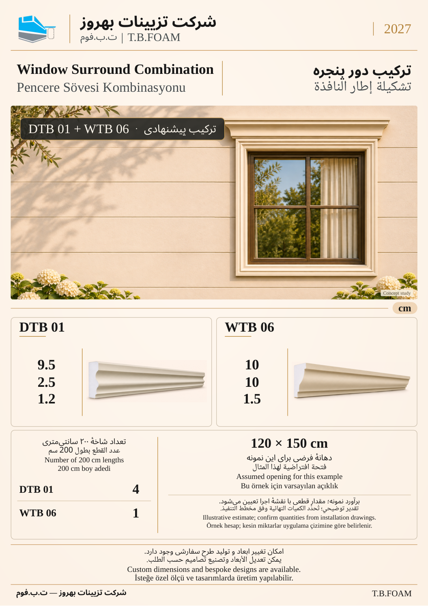

[بازکردن مستقیم تصویر](https://raw.githubusercontent.com/peymanshakernia/catalouge/main/catalog/pages/review/combinations-2027/WIN-COMB-NC-01.png) · [صفحهٔ مستقل](01.md)

## نمونهٔ 2 — دور پنجرهٔ معاصر

**DTB 04 + FLTB 02**

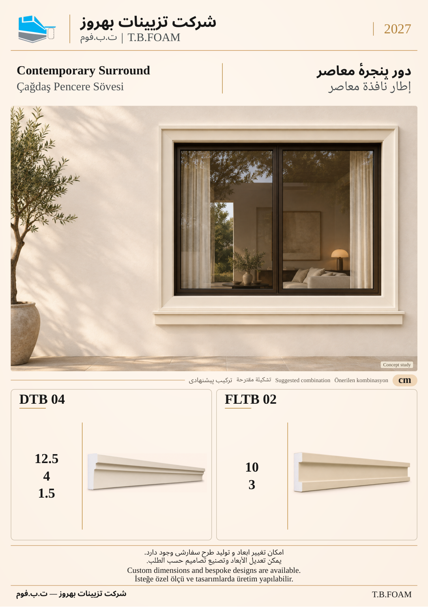

[بازکردن مستقیم تصویر](https://raw.githubusercontent.com/peymanshakernia/catalouge/main/catalog/pages/review/combinations-2027/COMB-02.png) · [صفحهٔ مستقل](02.md)

## نمونهٔ 3 — ترکیب بازشوی قوسی

**CDTB 01-B + FLTB 02**

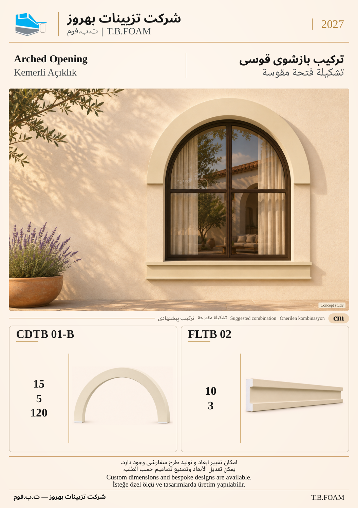

[بازکردن مستقیم تصویر](https://raw.githubusercontent.com/peymanshakernia/catalouge/main/catalog/pages/review/combinations-2027/COMB-03.png) · [صفحهٔ مستقل](03.md)

## نمونهٔ 4 — خطوط افقی در نما

**FLTB 03 + AFTB 06**

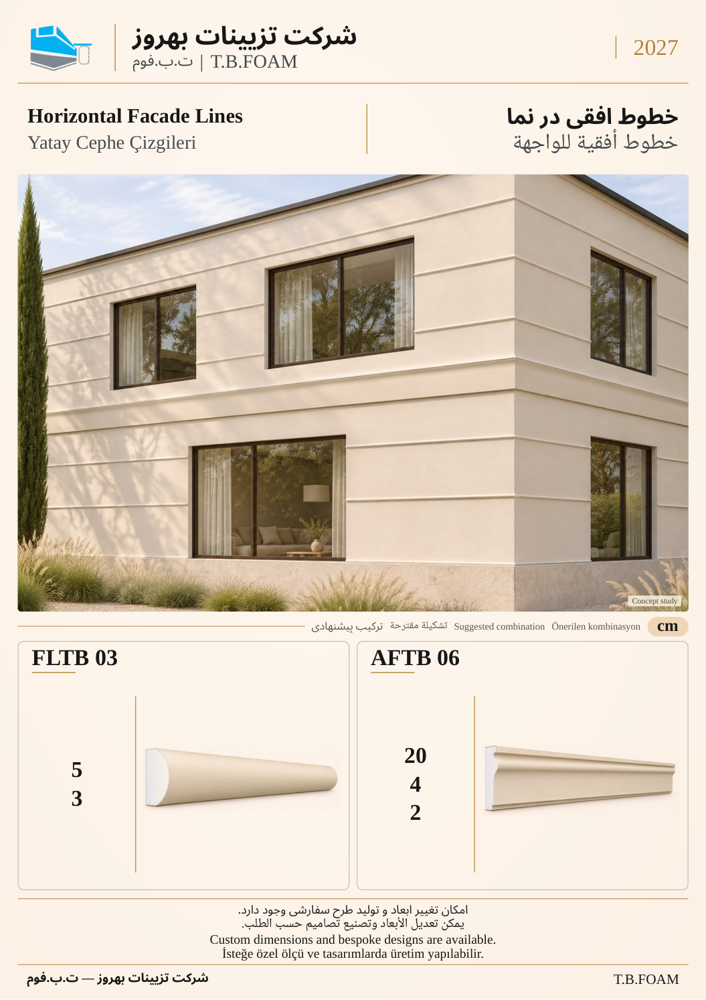

[بازکردن مستقیم تصویر](https://raw.githubusercontent.com/peymanshakernia/catalouge/main/catalog/pages/review/combinations-2027/COMB-04.png) · [صفحهٔ مستقل](04.md)

## نمونهٔ 5 — نمای معاصر و کنج

**FLTB 06 + CETB 01**

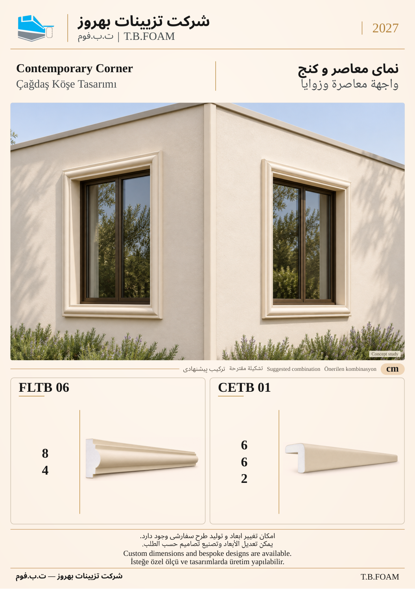

[بازکردن مستقیم تصویر](https://raw.githubusercontent.com/peymanshakernia/catalouge/main/catalog/pages/review/combinations-2027/COMB-05.png) · [صفحهٔ مستقل](05.md)

## نمونهٔ 6 — نمای نئوکلاسیک

**AFTB 04 + CRTB 03 + DTB 08**

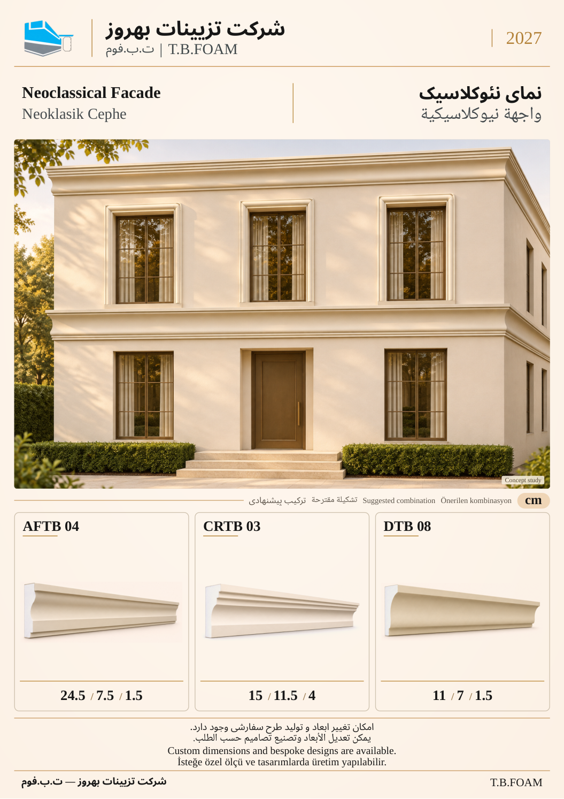

[بازکردن مستقیم تصویر](https://raw.githubusercontent.com/peymanshakernia/catalouge/main/catalog/pages/review/combinations-2027/COMB-06.png) · [صفحهٔ مستقل](06.md)

## نمونهٔ 7 — ابزار حجیم در نما

**AFTB 46 + CRTB 09**

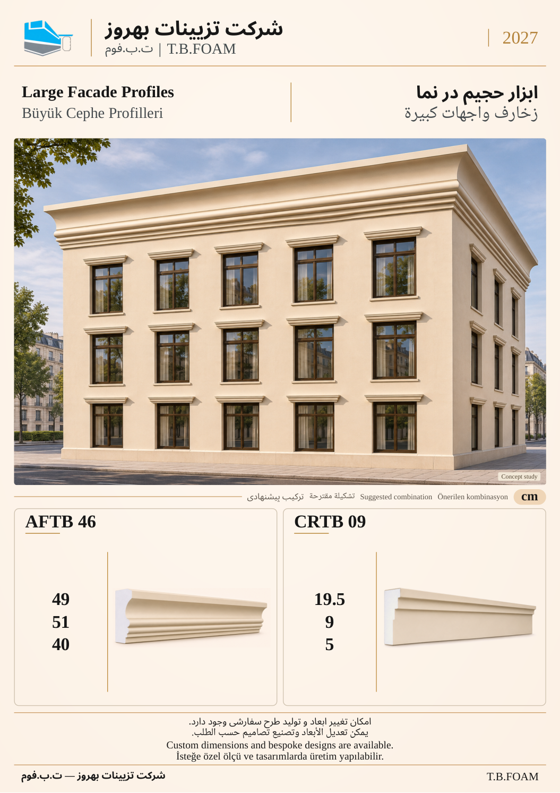

[بازکردن مستقیم تصویر](https://raw.githubusercontent.com/peymanshakernia/catalouge/main/catalog/pages/review/combinations-2027/COMB-07.png) · [صفحهٔ مستقل](07.md)

## نمونهٔ 8 — پانل و خطوط ظریف

**FTB 01-A + FLTB 07**

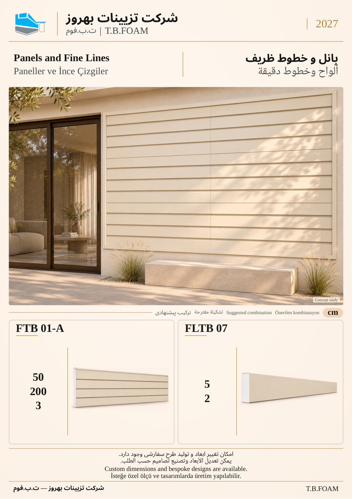

[بازکردن مستقیم تصویر](https://raw.githubusercontent.com/peymanshakernia/catalouge/main/catalog/pages/review/combinations-2027/COMB-08.png) · [صفحهٔ مستقل](08.md)

## نمونهٔ 9 — پانل و قاب پنجره

**FTB 06-A + DTB 12**

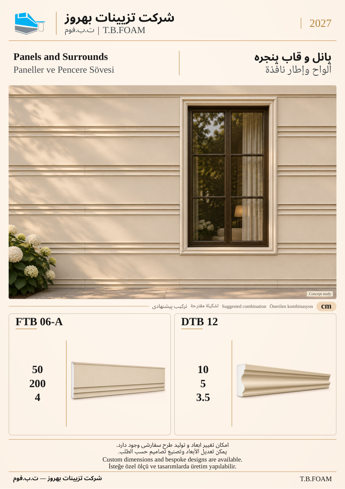

[بازکردن مستقیم تصویر](https://raw.githubusercontent.com/peymanshakernia/catalouge/main/catalog/pages/review/combinations-2027/COMB-09.png) · [صفحهٔ مستقل](09.md)

## نمونهٔ 10 — ورودی با ستون

**CTB 203 + CTB 114-C + CRTB 07**

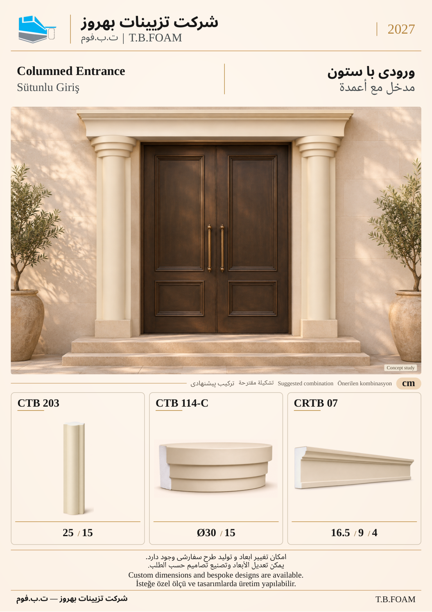

[بازکردن مستقیم تصویر](https://raw.githubusercontent.com/peymanshakernia/catalouge/main/catalog/pages/review/combinations-2027/COMB-10.png) · [صفحهٔ مستقل](10.md)

## نمونهٔ 11 — ورودی و کتیبه

**PCTB 02-C + CRTB 05 + ATB 02-A**

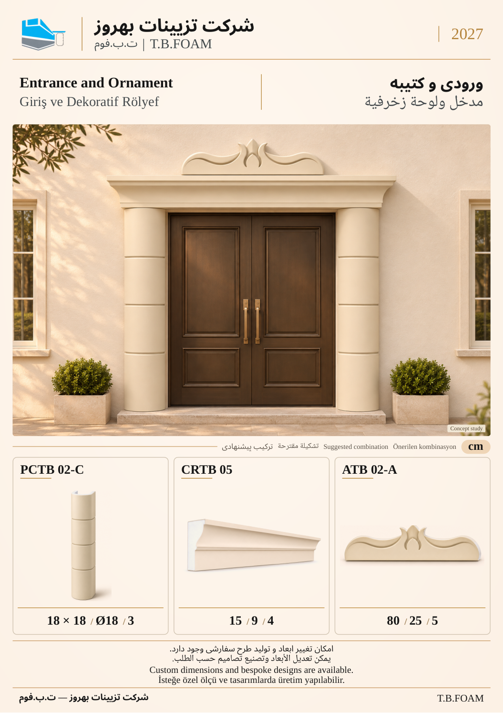

[بازکردن مستقیم تصویر](https://raw.githubusercontent.com/peymanshakernia/catalouge/main/catalog/pages/review/combinations-2027/COMB-11.png) · [صفحهٔ مستقل](11.md)

## نمونهٔ 12 — کنج و خط بام

**CETB 04 + CFTB 03 + AFTB 09**

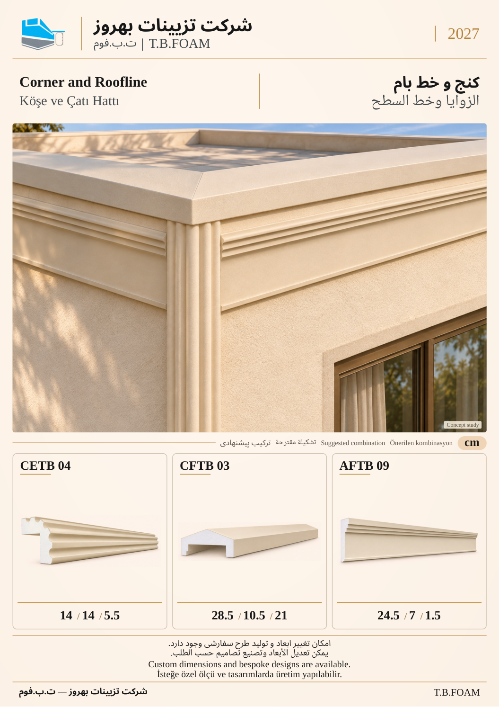

[بازکردن مستقیم تصویر](https://raw.githubusercontent.com/peymanshakernia/catalouge/main/catalog/pages/review/combinations-2027/COMB-12.png) · [صفحهٔ مستقل](12.md)

## فهرست لینک‌های مستقل

| نمونه | صفحهٔ مستقل | کد ابزارهای استفاده‌شده |
| --- | --- | --- |
| 1 | [قاب پنجره با تاج بالاسری](01.md) | DTB 01 + WTB 06 |
| 2 | [دور پنجرهٔ معاصر](02.md) | DTB 04 + FLTB 02 |
| 3 | [ترکیب بازشوی قوسی](03.md) | CDTB 01-B + FLTB 02 |
| 4 | [خطوط افقی در نما](04.md) | FLTB 03 + AFTB 06 |
| 5 | [نمای معاصر و کنج](05.md) | FLTB 06 + CETB 01 |
| 6 | [نمای نئوکلاسیک](06.md) | AFTB 04 + CRTB 03 + DTB 08 |
| 7 | [ابزار حجیم در نما](07.md) | AFTB 46 + CRTB 09 |
| 8 | [پانل و خطوط ظریف](08.md) | FTB 01-A + FLTB 07 |
| 9 | [پانل و قاب پنجره](09.md) | FTB 06-A + DTB 12 |
| 10 | [ورودی با ستون](10.md) | CTB 203 + CTB 114-C + CRTB 07 |
| 11 | [ورودی و کتیبه](11.md) | PCTB 02-C + CRTB 05 + ATB 02-A |
| 12 | [کنج و خط بام](12.md) | CETB 04 + CFTB 03 + AFTB 09 |

این مجموعه از ۲۷ کد متفاوت در ۱۳ گروه محصول استفاده می‌کند. اعداد ۱ تا ۱۲ ترتیب بازبینی هستند؛ شمارهٔ نهایی صفحات کاتالوگ بعداً تعیین می‌شود.

تصاویر کاربرد، مطالعهٔ مفهومی برای کمک به انتخاب‌اند و عکس پروژهٔ اجراشده یا نقشهٔ اجرایی معرفی نمی‌شوند. ابعاد محصولات مطابق جدول مادر مصوب است. مثال برآورد شاخه در صفحهٔ مستقل نمونهٔ اول آمده است.
