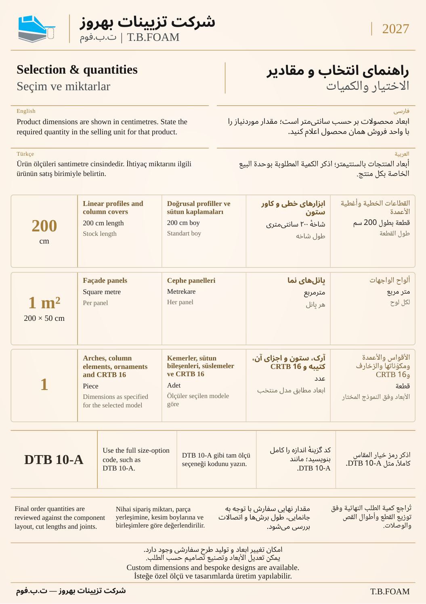
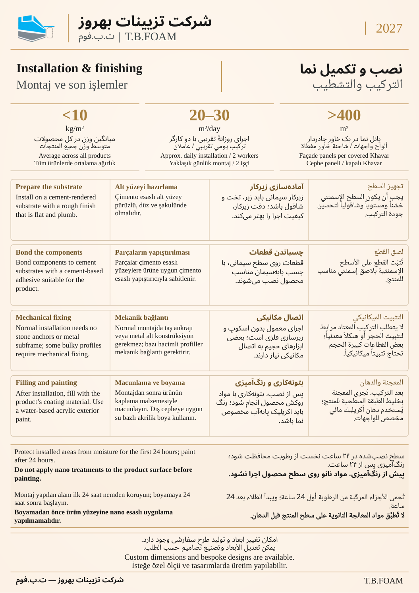
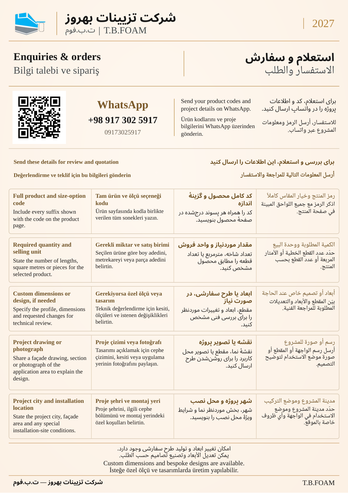

# راهنمای انتخاب، نصب و سفارش — کاتالوگ ۲۰۲۷

سه پیش‌نویس A4 عمودی، با هویت و لوگوی ثابت و محتوای فارسی، عربی، انگلیسی و ترکی استانبولی. تصاویر به‌ترتیب در همین صفحه نمایش داده می‌شوند؛ شمارهٔ نهایی چاپ پس از یکپارچه‌سازی تعیین خواهد شد.

## انتخاب و مقادیر

واحدهای فروش، اندازهٔ عرضه، کد کامل گزینهٔ اندازه و یادداشت برآورد مقدار.

## نصب و تکمیل نما

زیرکار و اتصال، بتونه‌کاری، رنگ مجاز و منع استفاده از نانو پیش از رنگ‌آمیزی.

## استعلام و سفارش

اطلاعات لازم برای بررسی پروژه و واتساپ تأییدشده به‌همراه QR.

شاخص‌های صفحهٔ نصب بر مبنای توضیح سازنده‌اند: میانگین وزن کل محصولات، ظرفیت حمل پانل نما با یک خاور چادردار و سرعت اجرای تقریبی توسط دو کارگر. قاعدهٔ حفاظت از رطوبت در۲۴ساعت نخست و رنگ‌آمیزی پس از۲۴ساعت هم درج شده است. این مجموعه برای بازبینی است؛ تأیید نهایی چاپ محسوب نمی‌شود.
